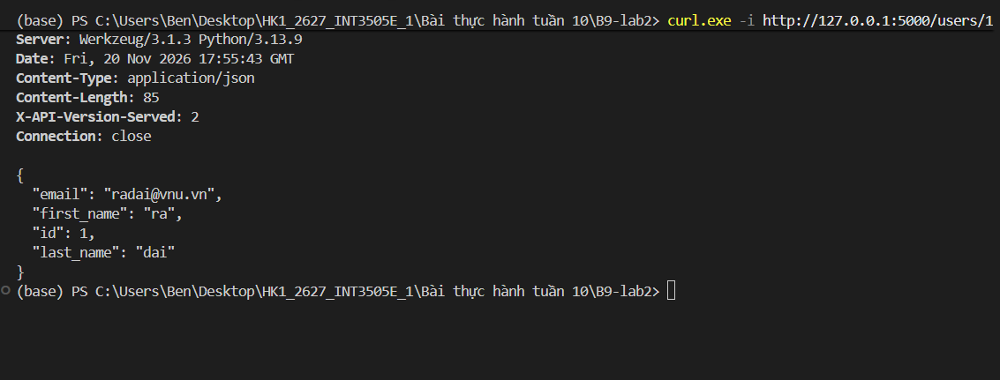
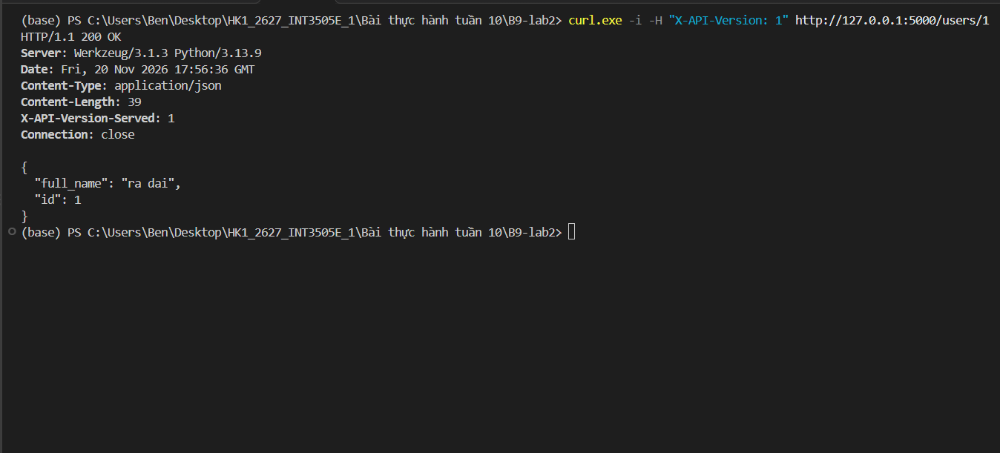
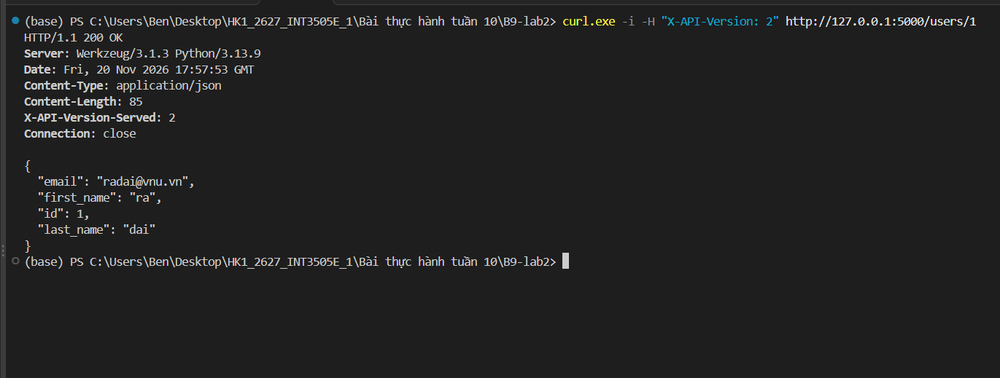
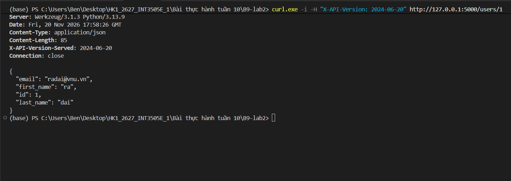
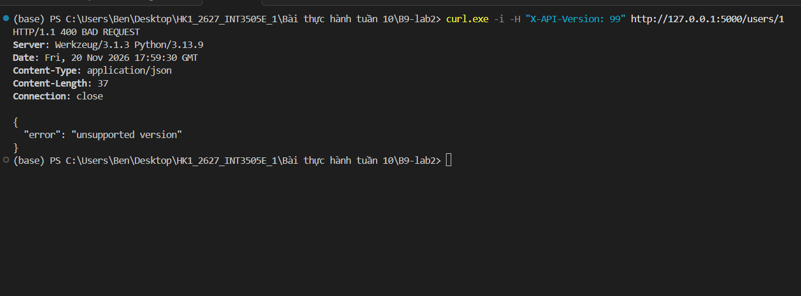
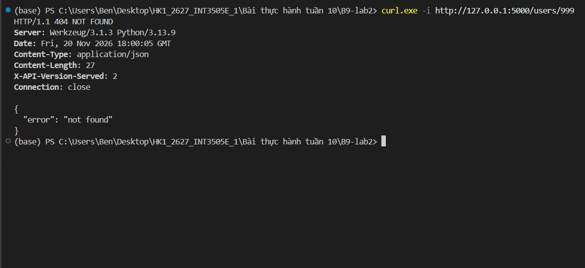

# Lab 2: Header Versioning với decorator @api_version


## 1. Demo API

### 1.1. Gọi mặc định không truyền header `X-API-Version` (mặc định v2)

**Lệnh thực thi (PowerShell):**
```powershell
curl.exe -i http://127.0.0.1:5000/users/1
```

**Request:**
```http
GET /users/1
```

**Response:**
- **Status:** `HTTP 200 OK`
- **Header:** `X-API-Version-Served: 2`

```json
{
  "email": "radai@vnu.vn",
  "first_name": "ra",
  "id": 1,
  "last_name": "dai"
}
```



### 1.2. Chỉ định phiên bản v1 (`X-API-Version: 1`)

**Lệnh thực thi (PowerShell):**
```powershell
curl.exe -i -H "X-API-Version: 1" http://127.0.0.1:5000/users/1
```

**Request:**
```http
GET /users/1
X-API-Version: 1
```

**Response:**
- **Status:** `HTTP 200 OK`
- **Header:** `X-API-Version-Served: 1`

```json
{
  "full_name": "ra dai",
  "id": 1
}
```



### 1.3. Chỉ định phiên bản v2 (`X-API-Version: 2`)

**Lệnh thực thi (PowerShell):**
```powershell
curl.exe -i -H "X-API-Version: 2" http://127.0.0.1:5000/users/1
```

**Request:**
```http
GET /users/1
X-API-Version: 2
```

**Response:**
- **Status:** `HTTP 200 OK`
- **Header:** `X-API-Version-Served: 2`

```json
{
  "email": "radai@vnu.vn",
  "first_name": "ra",
  "id": 1,
  "last_name": "dai"
}
```



### 1.4. Chỉ định phiên bản dạng ngày (`X-API-Version: 2024-06-20`)

**Lệnh thực thi (PowerShell):**
```powershell
curl.exe -i -H "X-API-Version: 2024-06-20" http://127.0.0.1:5000/users/1
```

**Request:**
```http
GET /users/1
X-API-Version: 2024-06-20
```

**Response:**
- **Status:** `HTTP 200 OK`
- **Header:** `X-API-Version-Served: 2024-06-20`

```json
{
  "email": "radai@vnu.vn",
  "first_name": "ra",
  "id": 1,
  "last_name": "dai"
}
```



### 1.5. Kiểm tra phiên bản không hợp lệ (`X-API-Version: 99`)

**Lệnh thực thi (PowerShell):**
```powershell
curl.exe -i -H "X-API-Version: 99" http://127.0.0.1:5000/users/1
```

**Request:**
```http
GET /users/1
X-API-Version: 99
```

**Expected Response:**
- **Status:** `HTTP 400 Bad Request`
- Response báo lỗi phiên bản không được hỗ trợ và không fallback về phiên bản mặc định:

```json
{
  "error": "unsupported version"
}
```



### 1.6. Kiểm tra user không tồn tại (`GET /users/999`)

**Lệnh thực thi (PowerShell):**
```powershell
curl.exe -i http://127.0.0.1:5000/users/999
```

**Request:**
```http
GET /users/999
```

**Expected Response:**
- **Status:** `HTTP 404 Not Found`
- **Header:** `X-API-Version-Served: 2`

```json
{
  "error": "not found"
}
```



---
