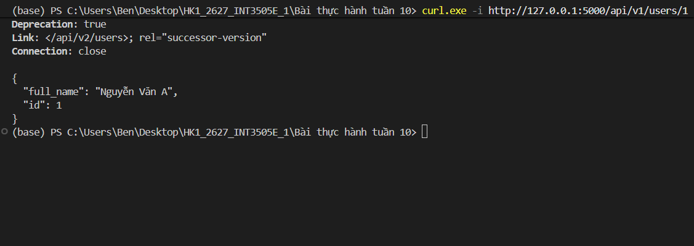
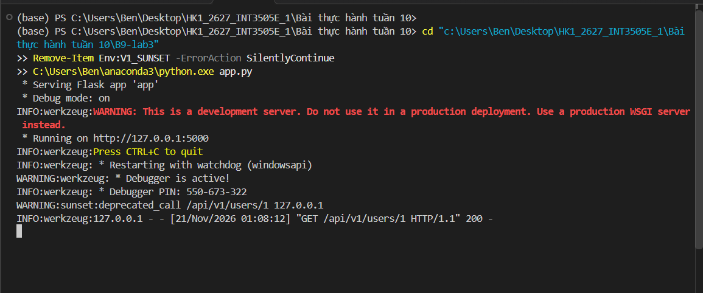
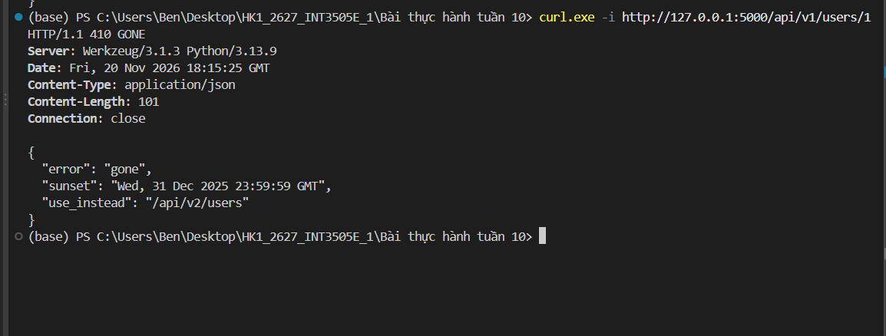

# Lab 3: Sunset Middleware với decorator @deprecate_at


---

## 1. Demo API

### 1.1. Trước ngày Sunset (mặc định `2026-12-31T23:59:59+00:00`)

**Lệnh thực thi (PowerShell):**
```powershell
curl.exe -i http://127.0.0.1:5000/api/v1/users/1
```

**Request:**
```http
GET /api/v1/users/1
```

**Response:**



### 1.2. Ghi log cảnh báo trên server khi endpoint deprecated được gọi

**Quan sát trên Terminal chạy Flask server:**
```text
WARNING:sunset:deprecated_call /api/v1/users/1 127.0.0.1
INFO:werkzeug:127.0.0.1 - - [...] "GET /api/v1/users/1 HTTP/1.1" 200 -
```



### 1.3. Sau ngày Sunset (giả lập bằng biến môi trường `V1_SUNSET`)

**Khởi động lại server với ngày Sunset trong quá khứ (Terminal 1 — PowerShell):**
```powershell
$env:V1_SUNSET="2025-12-31T23:59:59+00:00"
python app.py
```

**Lệnh thực thi (Terminal 2 — PowerShell):**
```powershell
curl.exe -i http://127.0.0.1:5000/api/v1/users/1
```

**Request:**
```http
GET /api/v1/users/1
```

**Expected Response:**
- **Status:** `HTTP 410 Gone`

```json
{
  "error": "gone",
  "sunset": "Wed, 31 Dec 2025 23:59:59 GMT",
  "use_instead": "/api/v2/users"
}
```



---
