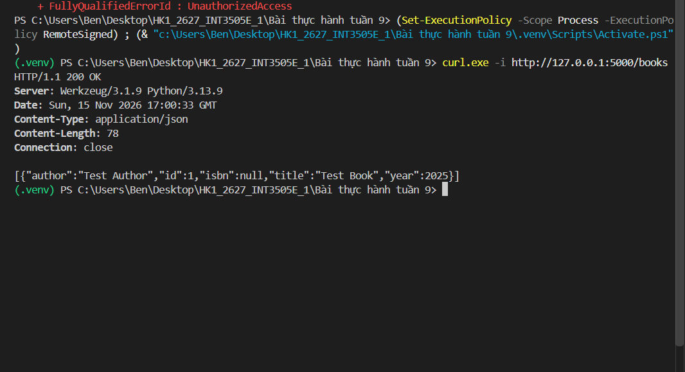
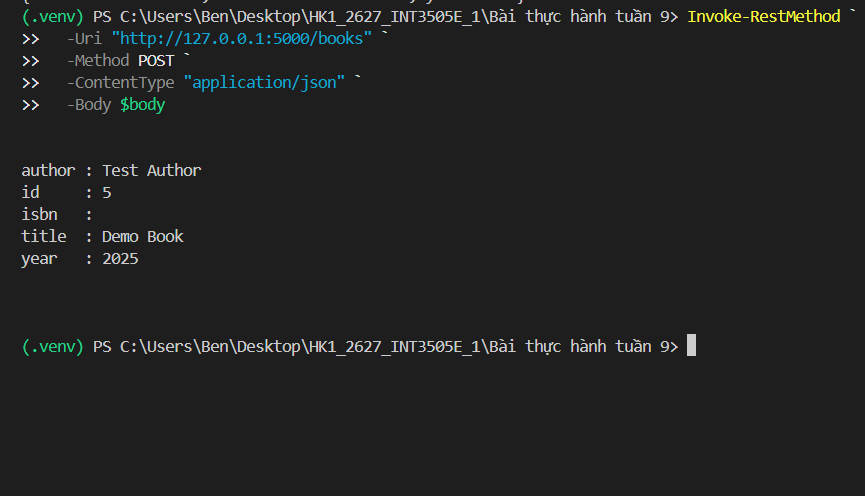
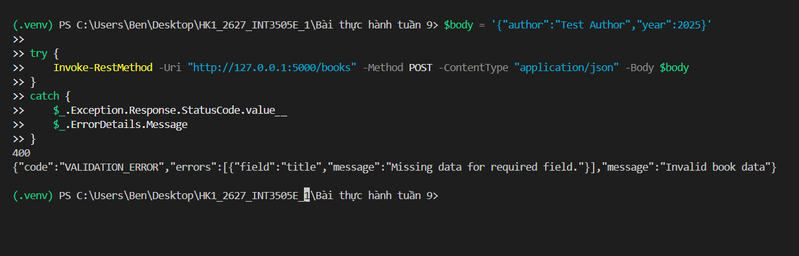
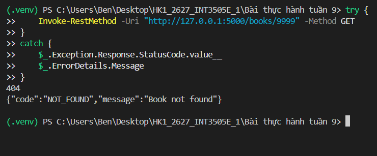
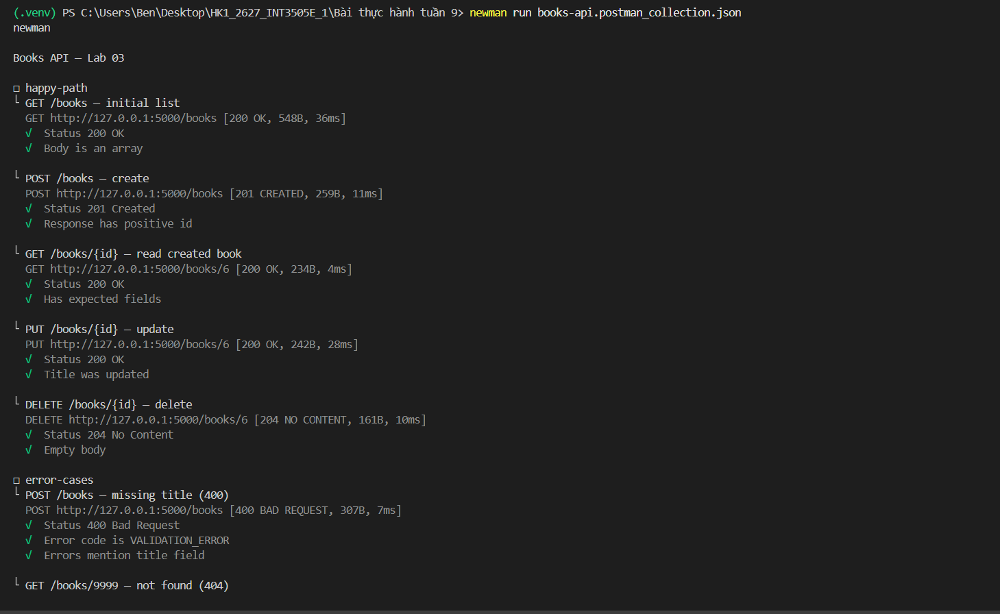
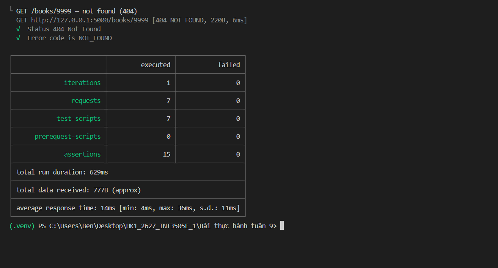

# Lab 3: Build Newman-runnable Collection

## 1. Giới thiệu
Tự động hóa kiểm thử API cho Books API bằng Postman Collection và Newman CLI. Bộ test bao gồm luồng hoạt động chuẩn (Happy path) và các trường hợp lỗi (Error cases), lưu trạng thái qua Collection Variable và xuất báo cáo kiểm thử chuẩn JUnit XML.

---

## 2. Demo API

### 2.1. Lấy danh sách sách

**Request:**
```http
GET /books
```

**Response:**
```json
[
  {
    "author": "Test Author",
    "id": 1,
    "isbn": null,
    "title": "Test Book",
    "year": 2025
  }
]
```



### 2.2. Tạo sách mới

**Request:**
```http
POST /books
Content-Type: application/json

{
  "title": "Demo Book",
  "author": "Test Author",
  "year": 2025
}
```

**Response:**
```json
{
  "author": "Test Author",
  "id": 5,
  "isbn": null,
  "title": "Demo Book",
  "year": 2025
}
```



### 2.3. Kiểm tra trường hợp thiếu title

**Request:**
```http
POST /books
Content-Type: application/json

{
  "author": "Test Author",
  "year": 2025
}
```

**Expected Response:**
- **Status:** `HTTP 400 Bad Request`
- Response chứa thông tin lỗi liên quan đến trường `title`:

```json
{
  "code": "VALIDATION_ERROR",
  "message": "Invalid book data",
  "errors": [
    {
      "field": "title",
      "message": "Missing data for required field."
    }
  ]
}
```



### 2.4. Kiểm tra ID không tồn tại

**Request:**
```http
GET /books/9999
```

**Expected Response:**
- **Status:** `HTTP 404 Not Found`
- Response chứa mã lỗi `NOT_FOUND`:

```json
{
  "code": "NOT_FOUND",
  "message": "Book not found"
}
```



---

## 3. Kết quả chạy Newman

**Command:**
```bash
newman run books-api.postman_collection.json
```

**Kết quả thực tế:**

- **Total Requests:** 7
- **Total Assertions:** 15
- **Passed:** 15
- **Failed:** 0
- **Duration:** 629ms

### Ảnh minh chứng chạy Newman:





### Chi tiết các test case thực thi:
1. `happy-path / GET /books — initial list`: Status 200 OK, Body is an array (Pass)
2. `happy-path / POST /books — create`: Status 201 Created, Response has positive id (Pass - lưu `book_id` vào biến)
3. `happy-path / GET /books/{id} — read created book`: Status 200 OK, Has expected fields (Pass)
4. `happy-path / PUT /books/{id} — update`: Status 200 OK, Title was updated (Pass)
5. `happy-path / DELETE /books/{id} — delete`: Status 204 No Content, Empty body (Pass)
6. `error-cases / POST /books — missing title (400)`: Status 400 Bad Request, Error code is VALIDATION_ERROR, Errors mention title field (Pass)
7. `error-cases / GET /books/9999 — not found (404)`: Status 404 Not Found, Error code is NOT_FOUND (Pass)

- **Báo cáo JUnit XML:** Được xuất tại `reports/junit.xml`.
