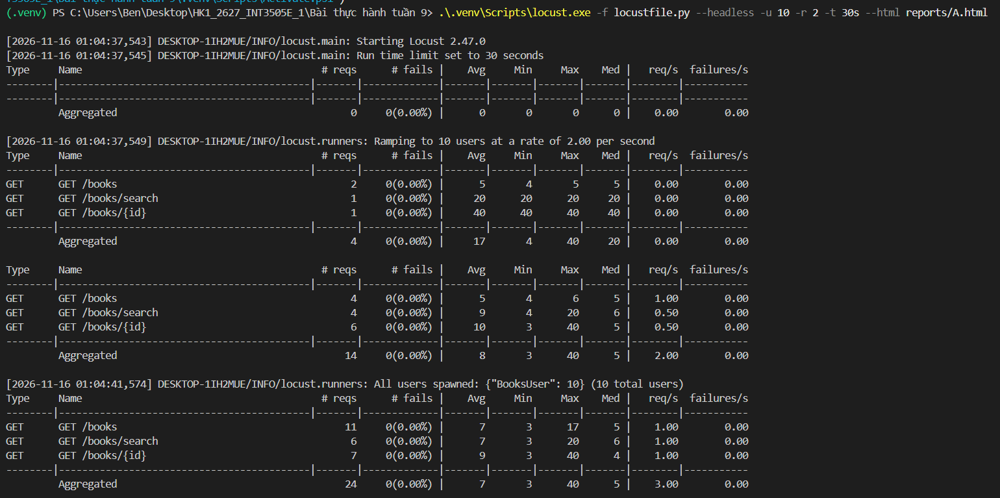
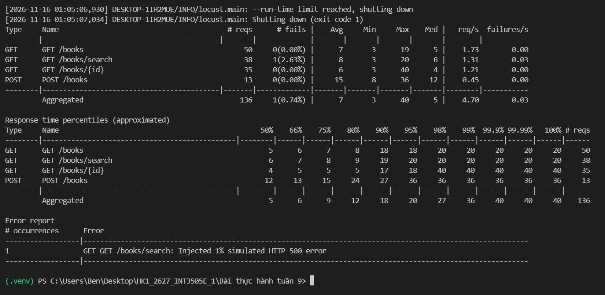
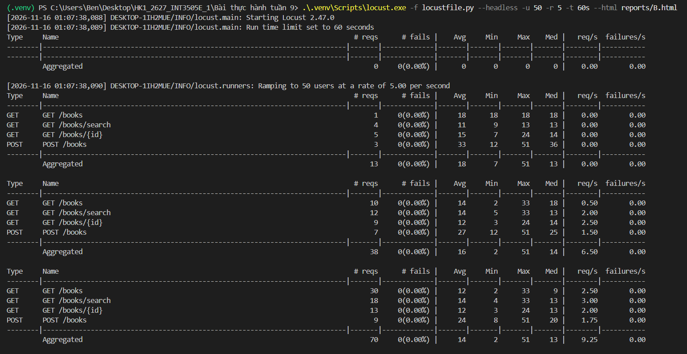
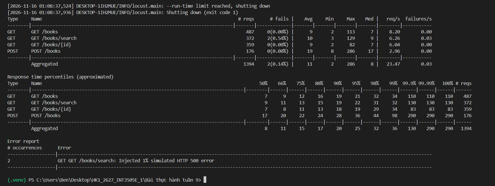
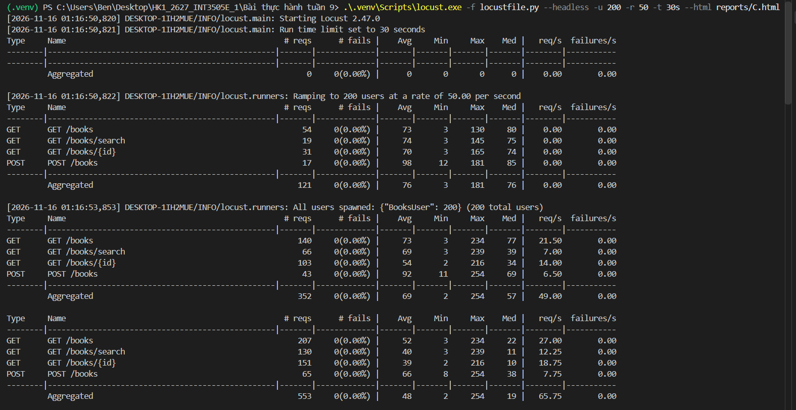
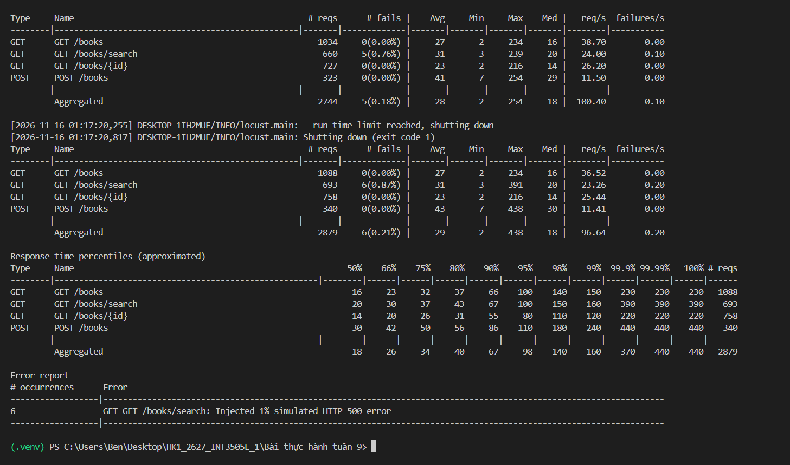

# Lab 4: Load Test Books API với Locust

## 1. Giới thiệu
Thực hiện kiểm thử tải (Load Testing) và đánh giá hiệu năng Books API sử dụng công cụ Locust (Python-native). Mục tiêu nhằm xác định khả năng chịu tải, phân bố thời gian đáp ứng (latency percentiles: median, p95, p99), tỷ lệ lỗi và xác định điểm nghẽn của hệ thống qua ba kịch bản: **Baseline (A)**, **Load test thông thường (B)**, và **Spike test (C)**.

---

## 2. Kịch bản kiểm thử và Kết quả thực tế

### 2.1. Kịch bản A — Baseline (Tải nhẹ)

- **Cấu hình:** 10 users, spawn rate 2 users/s, thời gian chạy 30s.
- **Lệnh thực thi:**
```bash
locust -f locustfile.py --headless -u 10 -r 2 -t 30s --html reports/A.html
```

#### Quá trình chạy:


... *(quá trình mô phỏng người dùng tăng dần)* ...

#### Kết quả kết thúc Kịch bản A:


- **Tổng số requests:** 136
- **RPS trung bình:** 4.70 req/s
- **Thời gian phản hồi trung bình (Avg):** 7 ms
- **Median (50%ile):** 5 ms | **p95:** 20 ms | **p99:** 36 ms | **Max:** 40 ms
- **Tỷ lệ lỗi (Fail rate):** 0.74% (1 lỗi giả lập `Injected 1% simulated HTTP 500 error` trên endpoint `GET /books/search`).

---

### 2.2. Kịch bản B — Load test (Tải thông thường)

- **Cấu hình:** 50 users, spawn rate 5 users/s, thời gian chạy 60s.
- **Lệnh thực thi:**
```bash
locust -f locustfile.py --headless -u 50 -r 5 -t 60s --html reports/B.html
```

#### Quá trình chạy:


... *(hệ thống duy trì tải ổn định trong 60 giây)* ...

#### Kết quả kết thúc Kịch bản B:


- **Tổng số requests:** 1,394
- **RPS trung bình:** 23.47 req/s
- **Thời gian phản hồi trung bình (Avg):** 11 ms
- **Median (50%ile):** 8 ms | **p95:** 25 ms | **p99:** 36 ms | **Max:** 286 ms
- **Tỷ lệ lỗi (Fail rate):** 0.14% (2 lỗi giả lập `Injected 1% simulated HTTP 500 error` trên endpoint `GET /books/search`).

---

### 2.3. Kịch bản C — Spike test (Tải đột biến)

- **Cấu hình:** 200 users, spawn rate 50 users/s, thời gian chạy 30s.
- **Lệnh thực thi:**
```bash
locust -f locustfile.py --headless -u 200 -r 50 -t 30s --html reports/C.html
```

#### Quá trình chạy:


... *(tải tăng vọt lên 200 người dùng đồng thời chỉ trong 4 giây)* ...

#### Kết quả kết thúc Kịch bản C:


- **Tổng số requests:** 2,879
- **RPS trung bình:** 96.64 req/s
- **Thời gian phản hồi trung bình (Avg):** 29 ms
- **Median (50%ile):** 18 ms | **p95:** 98 ms | **p99:** 160 ms | **Max:** 438 ms
- **Tỷ lệ lỗi (Fail rate):** 0.21% (6 lỗi giả lập `Injected 1% simulated HTTP 500 error` trên endpoint `GET /books/search`).

---

## 3. Bảng tổng hợp số liệu và Phân tích hiệu năng

### 3.1. Bảng so sánh 3 kịch bản

| Kịch bản | Users | Spawn rate | Duration | Requests | RPS | Fail rate | Median | p95 | p99 | Max |
| :--- | :---: | :---: | :---: | :---: | :---: | :---: | :---: | :---: | :---: | :---: |
| **A (Baseline)** | 10 | 2 | 30s | 136 | 4.70 | 0.74% | 5 ms | 20 ms | 36 ms | 40 ms |
| **B (Load test)** | 50 | 5 | 60s | 1,394 | 23.47 | 0.14% | 8 ms | 25 ms | 36 ms | 286 ms |
| **C (Spike test)** | 200 | 50 | 30s | 2,879 | 96.64 | 0.21% | 18 ms | 98 ms | 160 ms | 438 ms |

---

### 3.2. Trả lời các câu hỏi phân tích

#### 1. Kịch bản nào có p95 cao nhất? Vì sao?
- **Kịch bản C (Spike test)** có `p95` cao nhất (`98 ms`), cao gấp khoảng 4 - 5 lần so với Kịch bản A (`20 ms`) và Kịch bản B (`25 ms`). Cụ thể:
  - `POST /books`: p95 = 110 ms, p99 = 240 ms, Max = 438 ms.
  - `GET /books/search`: p95 = 100 ms, p99 = 160 ms, Max = 391 ms.
  - `GET /books`: p95 = 100 ms, p99 = 150 ms, Max = 234 ms.
  - `GET /books/{id}`: p95 = 80 ms, p99 = 120 ms, Max = 216 ms.
- **Nguyên nhân:** Kịch bản C đẩy từ 0 lên 200 người dùng trong thời gian rất ngắn (chỉ 4 giây). Lượng request dồn dập khiến hàng đợi của Flask development server bị dồn ứ. Đồng thời, thao tác `POST /books` thực hiện ghi vào SQLite gây tranh chấp lock cơ sở dữ liệu dạng file (`database-level lock`), khiến độ trễ ở đuôi phân phối (*tail latency*) tăng cao rõ rệt.

#### 2. Endpoint nào có fail rate tăng theo số user? Phân tích nguyên nhân dựa trên code.
- **Hiện tượng:** Chỉ có endpoint `GET /books/search` xuất hiện lỗi trong bảng Error report:
  - Kịch bản A: 1 lỗi / 38 requests (2.63%)
  - Kịch bản B: 2 lỗi / 372 requests (0.54%)
  - Kịch bản C: 6 lỗi / 693 requests (0.87%)
- **Nguyên nhân:** Toàn bộ các lỗi này là **lỗi tiêm giả lập ở phía client load test (`locustfile.py`)**, hoàn toàn **không phải lỗi do server API**:
  ```python
  if random.random() < 0.01:
      response.failure("Injected 1% simulated HTTP 500 error")
  ```
  Phía backend Flask (`app.py`), logic xử lý trả về HTTP 200 đầy đủ cho mọi request hợp lệ, không có ngoại lệ hay lỗi crash nào xảy ra trên server. Tỷ lệ lỗi duy trì quanh mức ~1% là do xác suất ngẫu nhiên của code test.

#### 3. Nếu production yêu cầu SLO p95 < 300ms, kịch bản nào đạt? Đề xuất baseline cho CI gate.
- **Đánh giá theo SLO:**
  - **Kịch bản A (10 users):** `p95 = 20 ms` < 300 ms ➔ **ĐẠT**.
  - **Kịch bản B (50 users):** `p95 = 25 ms` < 300 ms ➔ **ĐẠT**.
  - **Kịch bản C (200 users):** `p95 = 98 ms` < 300 ms ➔ **ĐẠT**.
- **Giới hạn phép đo:** Thử nghiệm chạy trên máy cá nhân với Flask development server và SQLite. Môi trường production thực tế thường chạy trên các WSGI/ASGI server công nghiệp (như Gunicorn/Uvicorn), sau Nginx reverse proxy và sử dụng hệ quản trị CSDL độc lập (PostgreSQL/MySQL).
- **Đề xuất baseline cho CI gate:**
  - Cấu hình chạy: 20 – 50 users trong 30s.
  - Ngưỡng đánh giá (CI gate rule):
    - `p95 < 100 ms`
    - `Fail rate <= 1.5%` (cho phép dung sai do tiêm lỗi 1% giả lập)
    - `RPS >= 20 req/s`

#### 4. Câu hỏi Bonus: Hiện tượng khi Connection Pool giới hạn 5 với 200 user đồng thời và cách xác nhận bằng Locust.
- **Phân tích hiện tượng:** Khi connection pool bị giới hạn ở 5, chỉ có tối đa 5 kết nối CSDL được thực thi đồng thời. 195 request còn lại sẽ phải xếp hàng trong connection pool queue của SQLAlchemy. Nếu thời gian chờ vượt quá `pool_timeout` (mặc định 30 giây), SQLAlchemy sẽ ném lỗi `TimeoutError: QueuePool limit of size 5 overflow 10 reached, connection timed out`. Server sẽ trả về hàng loạt mã lỗi **HTTP 500 Internal Server Error**, throughput (RPS) giảm mạnh và độ trễ tăng vọt tới ngưỡng timeout (>= 30s).
- **Cách xác nhận bằng Locust:**
  1. Trong bảng **Failures / Error report**, xuất hiện lỗi `HTTPError("500 Internal Server Error")` hoặc connection timeout.
  2. Trên đồ thị **Total Requests per Second**, đường Requests/s sụt dốc trong khi đường Failures/s tăng dựng đứng.
  3. Trên đồ thị **Response Times (ms)**, đường p95/p99 tăng vọt chạm ngưỡng 30,000 ms.
